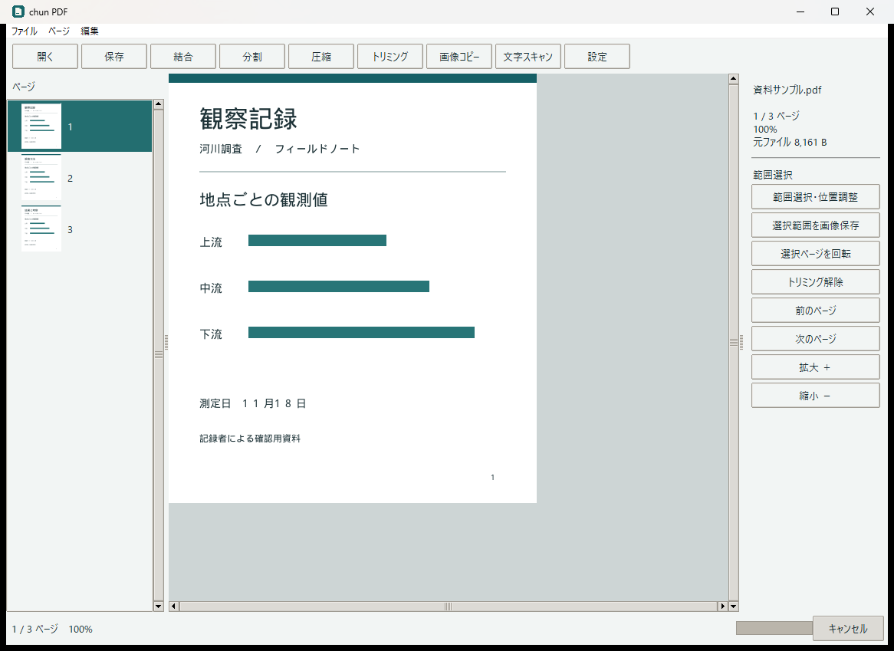

# chun PDF

Windows 11 x64 向けの日本語PDF編集アプリです。PDF・画像・OCRはPC内で処理します。ログインやPythonの追加インストールは不要です。



## ダウンロード

|用途|ダウンロード|起動方法|
|---|---|---|
|インストールして使う|[インストーラー版ZIP](https://github.com/kosukechun/chun_PDF/raw/refs/heads/main/downloads/chunPDF-Setup-x64.zip)|エクスプローラーで「すべて展開」し、中の `chunPDF-Setup-x64.exe` を実行します。|
|インストールせず使う|[ポータブル版ZIP](https://github.com/kosukechun/chun_PDF/raw/refs/heads/main/downloads/chunPDF-Portable-x64.zip)|フォルダー全体を展開して `chunPDF.exe` を実行します。`_internal` はEXEと一緒に置いてください。|

[SHA256一覧](downloads/SHA256SUMS.txt) は PowerShell の `Get-FileHash ファイル名` で照合できます。EXEはコード署名されていないため、Windows SmartScreenが発行元や実行について警告することがあります。組織の端末では管理者のルールに従ってください。

## ページの編集

1. 「開く」またはPDFのドラッグ＆ドロップでページを追加します。「結合」ではファイルごとに必要なページ範囲を選べます。パスワード付きPDFはパスワードを入力します。
2. 左のサムネイルを選びます。複数選択はCtrlまたはShiftを使います。ドラッグで順番を変更できます。「ページ」メニューで回転、削除、複製、空白追加、選択ページの保存を行います。「別PDFにコピー」「別PDFに移動」では挿入先PDFと位置を選び、新しいPDFとして保存します。「移動」では保存成功後に作業一覧から元の選択ページを外します。
3. 「保存」で一覧を1つの新しいPDFとして保存します。Ctrl+Zで元に戻し、Ctrl+Yでやり直せます。「分割」では1ページずつ、指定枚数ごと、奇数・偶数、または `1-3, 5` などの範囲を選びます。
4. 「圧縮」でロスレス、標準、高圧縮、カスタムを選択します。画像の解像度とJPEG品質を下げると見た目が変わります。保存後に元ファイルの合計と出力サイズを表示します。編集・抽出後の比較にはページ数の違いも含まれます。

## 範囲選択、トリミング、画像・文字コピー

- 右側の「範囲選択・位置調整」でプレビュー上をドラッグします。枠の内側で移動、四隅でサイズ変更できます。Ctrl＋ホイールでズーム、ホイールでスクロールします。
- 「トリミング」で範囲を確認し、現在・指定・全ページに適用します。これから枠を描く場合は描いたあとに再度「トリミング」を押してください。異なるサイズのページには表示上の左上を基準に同じポイント数を適用します。「トリミング解除」で選択ページに今回適用した変更を戻せます。CropBoxの外の情報は残ります。機密情報の削除には使えません。
- 「画像コピー」（F6）で範囲をドラッグし、WordなどでCtrl+Vします。設定のDPIで描画するため表示倍率に依存しません。右クリックから既存の範囲をコピー、PNG/JPEGとして保存できます。
- 「文字スキャン」（F7）で範囲をドラッグします。既存文字がある場合はその文字を読み、画像だけの場合は内蔵OCRを使います。結果画面で修正して「コピー」を押します。設定で日英混在、日本語、英語、縦書き日本語を切り替えられます。表、数式、小さな文字では認識結果を確認してください。長い処理は下部のボタンでキャンセルできます。
- 「編集」で文字、四角形、線、矢印、ハイライト、下線、メモ、画像を追加します。最後に追加した要素は新しい範囲へ移動できます。文字サイズは追加時に選びます。文字の直接置換、墨消し、既存オブジェクトの自由編集には対応していません。

## 通知領域と設定

トレイアイコンのダブルクリックで画面を表示します。右クリックから開く・結合・圧縮・設定・終了を選べます。「閉じるボタンでトレイに格納」は設定画面で切り替えます。「終了」でプロセスも停止します。二重に起動すると既存の画面が開きます。

「Windows起動時に自動起動」は初期状態でオフです。オンにするとユーザー単位で登録し、サインイン時にトレイへ起動します。ポータブル版を移動した場合は新しい場所から起動すれば登録を修復します。設定は `%APPDATA%\chunPDF` に保存します。

インストール版はWindowsの「設定」→「アプリ」→「インストールされているアプリ」から削除します。ポータブル版は自動起動をオフにし、トレイメニューで終了してフォルダーを削除します。

## ソースからのビルド

Windows x64、Python 3.12（3.11でも動作）、Inno Setup 6を用意します。PowerShellでリポジトリのフォルダーを開きます。

```powershell
py -3.12 -m venv .venv
.\.venv\Scripts\python -m pip install -r requirements.txt
.\.venv\Scripts\python app.py
.\.venv\Scripts\python build.py
```

コンパイラーの場所を指定する場合は `build.py --iscc "C:\path\to\ISCC.exe"` を使います。ビルドはpytest、GUI・日本語OCRを含む生成EXEのセルフテスト、インストーラー・ZIP・SHA256の作成を順に行います。成果物は `downloads/` に出力します。

GitHubの「Actions」→「Windows build」→「Run workflow」で再生成できます。mainへの変更、またはmainの現行コミットに付けた `v*` タグでも動作します。成果物はActionsのArtifactsに保存し、公開対象のビルドはZIPとハッシュをmainの `downloads/` にコミットします。書き込み可能なActionsトークンが必要です。

## アイコン、スクリーンショット、制限

参照画像がないため仮アイコンを使用しています。`assets/app_icon.png` を正方形の画像に置き換えてビルドすると、ウィンドウ・トレイ・EXE・セットアップに反映されます。スクリーンショットは `docs/screenshots/` 配下に追加できます。

アプリ独自のPDF容量・ページ数上限はありません。ページ画像はオンデマンドで描画し、サムネイルは表示中の行だけ保持します。大きなページのプレビューや一覧更新では待ち時間が生じます。出力文書の組み立てはメモリと一時ディスクを使用します。2 GB超の処理能力は実ファイル・PC環境に依存します。

保存時はページから新しいPDFを構築します。文書レベルのしおり、添付、署名、暗号化設定などは引き継ぎません。内部ページリンクやフォームの動作も変わることがあります。暗号化された入力から保存したPDFは暗号化されません。「ページ全体を画像化」は各ページをJPEGに変換するため、検索・文字選択・リンク・フォームなどが失われます。保存先には元PDFとは別の名前を指定してください。

アプリはGNU AGPL v3で公開します。[ライセンス全文](LICENSE)・[第三者ライセンス](THIRD_PARTY_LICENSES.md)。


